# Jute Transfer Chain — Process Walk-through & Review

**Date:** 2026-09-03
**Scope:** Gate Entry → Material Inspection (QC) → MR → Pending/Approve → juteTransfer (vertical
chain / marked stock) → Raw-Jute sales invoices → Jute Issue → reports, on the **sls** tenant.
**Status:** Review completed 2026-09-03; owner rulings and the implementation that followed are in §11 (code uncommitted on `bug-fix4`, dev3 migrated, sls not). Every claim cites `repo/path:line` read during this
review, or a SELECT-only probe of the live sls database run on 2026-09-03. Findings went through a
three-lens adversarial verification (code / live data / business semantics); severities below are the
post-verification ones.
**Repos:** `vowerp3be` (ERP backend), `vowerp3ui` (ERP frontend), `juteTransfer` (sls-only Streamlit
app that writes raw SQL straight into the sls tenant DB, bypassing the ERP API).

---

## 0. Summary

The chain works as a sequence of screens, but there is **no contract between the ERP and
juteTransfer**. The ERP marks an MR "Pending (13) — handed off to external system" and stops.
juteTransfer never reads that status: it lets any MR (Open, Approved, Pending) become a chain root,
and nothing on the ERP side knows a chain exists. Every one of the five reported problems traces to
that missing contract plus two writers with no status guard (`update_mr`, `jute_gate_entry_update`)
and one status setter with no rules (`change_status`).

| # | Your point | What the code does today | Live sls evidence |
|---|-----------|--------------------------|-------------------|
| P1 | Party details before Pending / Approved | `pending_mr` checks nothing; `approve_mr` only checks branch when a party is set; `change_status` can jump to 3/13 from anywhere | 7 of 72 Pending and 12,334 of 24,270 Approved MRs have **no party branch**; party itself is never missing |
| P2 | Rollback status handling | No reopen endpoint. The only way back from 13/3 is the hidden `change_status`, a bare UPDATE that clears nothing. Reject/Cancel ignore issues and chain children. Re-approval mints a new bill-pass number. juteTransfer writes status **0** (not a real status) on un-finalize and **1** on full chain delete | 8 chain roots sit at Open (1) today and can be Rejected/Cancelled with hops attached; 131 orphan issue rows (2,048 kg, all historical) |
| P3 | Nothing changes after Pending; chain rollbacks consistent | ERP: `update_mr`/gate-entry rewrite lines at any status; ERP has no `src_jute_mr_id` in its ORM so it cannot even ask "is this a root". juteTransfer: no root status gate; hop delete has no issue guard; revert restores rate only, not weights or party | Roots by status: 27 @13, 23 @3, 8 @1. **21 of 58 roots were edited after their first hop existed** |
| P4 | Receipt changes not synced to Jute Issue | Nothing syncs. Issue rows are frozen at write time; the stock view recomputes live from current line weights; writers never look at issues | FY26-27: 26 of 212 issued lines exceed approved weight (2,518 kg) — every sampled case is a line consumed **exactly to its net weight** |
| P5 | Net vs approved weight both updated | Three bases (net = `actual_weight`, approved = `accepted_weight`, header weighbridge) plus a Bill Pass override. Money uses approved, stock/issue uses net. `total_price` is never written by the ERP; `pending_mr` computes no totals at all | `accepted_weight` is NULL on **100 %** of pre-FY26-27 lines; 27 Pending roots were handed to juteTransfer with a zero money total |

**Recommendation (one design, §9):** define the contract in writing first (§8 decisions), then ship
the minimal guard set — one shared party helper, a freeze at 13/3, a sanctioned rollback that clears
what approval created, root-status preflight in juteTransfer, valid revert statuses — plus one
reconciliation report. Do not auto-rewrite issue rows; block the edit and surface the delta.

---

## 1. The chain as it runs today — step by step

| # | Step | Screen (vowerp3ui) | Endpoint (vowerp3be) | What is written | jute_mr status after | Guards that actually exist |
|---|------|--------------------|----------------------|-----------------|----------------------|----------------------------|
| 1 | **Gate Entry IN** | `jutePurchase/gateEntry/createGateEntry` | `POST /juteGateEntry/jute_gate_entry_create` (`juteGateEntry.py:579`) | `jute_mr` row + `jute_mr_li` lines. Header: `net_weight = gross − tare`, `actual_weight = net − variable_shortage` (`juteGateEntry.py:632-676`); `mr_weight = Σ line actual_weight`; `qc_check = 0`. **No party fields on this screen** (only `jute_supplier_id`). | **1 OPEN** | none on party |
| 2 | **Gate Entry OUT / edit** | row editable until `out_time` set (`gateEntry/page.tsx:161-164`) | `PUT /juteGateEntry/jute_gate_entry_update/{id}` (`juteGateEntry.py:749`) | tare / shortage / out_time. **If `line_items` is in the payload it DELETEs every `jute_mr_li` row and re-INSERTs new rows with new PKs** (`juteGateEntry.py:1050-1103`). The shipped FE never sends `line_items` (`createGateEntry/page.tsx:393-423`), so this branch is latent. | unchanged | reads `status_id` (`:776`) but never checks it; `qc_check` gates a few fields; OUT blocked until `qc_check = 1` |
| 3 | **Material Inspection (QC)** | `jutePurchase/materialInspection/createMaterialInspection` | `POST /materialInspection/complete_inspection` (`materialInspection.py:633`; also `save_only`) | Per line: item, quality, warehouse, `rate`, moisture, `claim_dust`, `shortage_kgs`, **`accepted_weight` = actual − moisture-over-allowable − dust** (`materialInspection.py:804-816`). Header: **party_id / party_branch_id are entered here** (FE `page.tsx:428-488, 833-834`) and `qc_check = 1`. Lines not in the payload are soft-deactivated (`active = 0`, `:951-966`). | unchanged (1) | one-shot: refuses once `qc_check = 1` (`:668`). Nothing ever resets `qc_check`. QC-Complete validation **does not require party** (FE `:733-746`). |
| 4 | **MR edit** | `jutePurchase/mr/edit` | `PUT /juteMR/update_mr/{id}` (`mr.py:619`) | party / party branch / remarks / all line fields; re-derives `accepted_weight` with a second formula that rounds to whole kg first (`mr.py:676-694`); writes `mr_weight`; **never writes `total_price` or header totals**. | unchanged | **no status check** — callable at 13 or 3. FE hides the form when status ∉ {21, 1} (`mr/edit/page.tsx:532-536`) — client-side only. `party_branch_id` is written from the body unconditionally (NULL if omitted) (`mr.py:745-767`). |
| 5a | **MR → Pending** (top-level approver's button) | `MRApprovalBar` → `handlePending` (`useMRApproval.ts:283-303`) | `POST /juteMR/pending_mr` (`mr.py:1250`) | `status_id = 13` only. **No numbers computed** (no `branch_mr_no`, `bill_pass_no`, totals, TDS). | **13 PENDING** — "terminal on MR screen, handed off to external system" (`constants.py:8`) | from 1 or 20 only. **No party / party-branch check** (BE or FE). |
| 5b | **MR → Approve** | `handleApprove` (`useMRApproval.ts:316-353`) | `POST /juteMR/approve_mr` (`mr.py:1329`) | Final level: `mr_date` mandatory; `branch_mr_no` kept if present else generated; **`bill_pass_no` always regenerated** (`mr.py:1448-1451` vs `:1501-1503`); `total_amount = Σ COALESCE(accepted_weight, actual_weight)/100 × rate` (`mr.py:1086-1113`), `claim_amount`, `roundoff`, `net_total`, 194Q TDS. | **3 APPROVED** (20 / 17 while walking levels) | from 1 or 20. Party guard is `if party_id and not party_branch_id` (`mr.py:1396-1400`) — an MR with no party at all passes. |
| 5c | Reject / Cancel | same bar | `POST /reject_mr` (1/20 → 4), `POST /cancel_mr` (1 → 6) | status only | 4 / 6 | no check for issues drawn or chain children |
| 5d | (hidden) generic setter | **no FE caller** | `PUT /juteMR/change_status/{id}` (`mr.py:807`) | `status_id = <anything>` | any | only guard: leaving 21 needs party + branch. **Any→any otherwise** (3→1, 13→1, 1→3 …), nothing cleared or recomputed. |
| 6 | **Bill Pass** | `jutePurchase/billPass/edit` | `PUT /billPass/update_bill_pass/{id}` (`billPass.py:321`) | `total_amount` / `claim_amount` / `tds_amount` from the body (FE recomputes them from lines and sends them disabled, so today they match); `roundoff` + `net_total` recomputed (`billPass.py:402-444`); never written back to lines. Complete → `bill_pass_complete = 1` + accounting `post_document` (`:481-484`). | 3 (requires 3) | own lock `bill_pass_complete = 1`, independent of MR status. **Never set to 1 on sls** (0 rows). |
| 7 | **Jute Issue** | `jutePurchase/juteIssue/edit` | `POST /juteIssue/create_issue` (`issue.py:853`), bulk open/approve/reject | `jute_issue`: `jute_mr_li_id`, `weight`, `quantity`, `issue_value = weight/100 × actual_rate` (`issue.py:943`). **Frozen at write time**; editable only while Draft (`issue.py:1021`). | n/a (own 21→1→3/4) | weight must fit `vw_jute_stock_outstanding.bal_weight` (**net basis**) at create/update (`issue.py:272-384`); MR must be in (1, 3, 13). `approve_issues` re-validates nothing. `jute_issue.jute_mr_li_id` has **no FK**. |
| 8 | **juteTransfer — Type 1 vertical chain** | `pages/new_transfer_chain.py` | direct SQL (`transfer.py`) | per hop: new `jute_mr` + `jute_mr_li` at buyer (`transfer_mode=0`, `src_jute_mr_id = ROOT`, `src_com_id = seller`, `status_id = 3`, own `bill_pass_no`) + Raw-Jute `sales_invoice` (`invoice_type = 5`, **inserted directly at status 3**, `transfer.py:995`). Money from `accepted_weight`; net/actual columns copied verbatim. Final hop back to origin **UPDATEs the root in place**: party ← last seller, rate, `branch_mr_no`, `bill_pass_no`, invoice fields, status 3 (`transfer.py:1225-1262`). | root: 3 (rewritten) | **no status gate anywhere** — root picker filters year/month/co/branch/transfer_mode only (`queries.py:146-220`); `new_transfer_chain.py` has zero `status_id` references |
| 9 | **juteTransfer — Type 2 lot / marked** | `pages/warehouse_stock.py` | `lot_ops.py`, `warehouse_stock_ops.py` | split/merge lines in place (provenance in `jute_lot_src`); marked move = child MR (`transfer_mode=1`, `src_jute_mr_id = direct parent`) + seller invoice; source line reduced on **all four** of `accepted_weight`, `total_price`, `actual_weight`, `actual_qty`; header recomputed on the approved basis only (`_recompute_mr_header`, `warehouse_stock_ops.py:59-79`). | child 3 | source must be **status 3**, mode 0, not a chain hop; availability = `LEAST(bal_weight, accepted_weight)` (`:124-140`, TOCTOU accepted) |
| 10 | **Reports / P&L** | `jutePurchase/reports/*`, juteTransfer P&L | `reportQueries.py`; `company_pl_dashboard.py` | see §4 | — | — |

**Where the "13 = handed off" hand-shake actually is: nowhere.** The ERP marks 13 and stops.
juteTransfer never reads 13 as an eligibility gate; the only place it looks at 13 is the P&L, where a
root at 1 or 13 means **"chain closed / origin consumed the jute"** (`queries.py:653-703`) — the
opposite of the ERP's meaning. juteTransfer's own writes to root status: **0** on un-finalize
(`transfer.py:1344`; not a row in `status_mst`), **1** on delete-whole-chain (`transfer.py:1669`;
demotes an Approved or Pending root to Open), **3** on finalize.

---

## 2. Status lifecycle — as coded

```mermaid
stateDiagram-v2
    [*] --> Open1: Gate Entry IN (jute_gate_entry_create)
    Draft21 --> Open1: open_mr (party + branch required; nothing creates Draft any more)
    Open1 --> Pending13: pending_mr (NO party check, NO totals)
    Open1 --> PendingApproval20: approve_mr + menu_id (first level; sls uses 17 for L2)
    PendingApproval20 --> PendingApproval20: approve_mr (next level)
    PendingApproval20 --> Pending13: pending_mr (top-level approver)
    PendingApproval20 --> Approved3: approve_mr (final; mr_date mandatory; numbers + totals + TDS)
    Open1 --> Approved3: approve_mr (no menu_id)
    Open1 --> Rejected4: reject_mr (issues / chain children not checked)
    PendingApproval20 --> Rejected4: reject_mr
    Open1 --> Cancelled6: cancel_mr
    state "any" as Any
    Any --> Any: change_status (hidden, any to any, clears nothing)
    Approved3 --> Approved3: juteTransfer finalize (root rewritten in place)
    Pending13 --> Approved3: juteTransfer finalize
    Approved3 --> Status0: juteTransfer un-finalize (0 is not in status_mst)
    Any --> Open1: juteTransfer delete whole chain from step 1
```

Status ids on sls (`status_mst`): 1 OPEN, 3 APPROVED, 4 REJECTED, 6 CANCELLED, 13 PENDING,
17 PENDING APPROVAL LEVEL 2, 20 PENDING APPROVAL LEVEL, 21 DRAFTED, 24 TRANSFER PENDING. Nothing in
either repo writes 24 (139 legacy rows). **Status 20 has zero rows on sls**; 17 has 31.

There is **no reopen endpoint for MR** (`approval_utils.py:551-554` still computes `canReopen` for
4/6 — dead flag). Nothing resets `qc_check` (QC is genuinely one-way). Nothing resets
`bill_pass_complete` (never set on sls anyway).

---

## 3. juteTransfer flows in detail

### 3.1 Type 1 — vertical chain (`transfer_mode = 0`)

1. User opens the Monthly MR Overview (co/branch/year/month) and row-clicks a root MR. **Any status
   is selectable** (`queries.py:146-220`). Live: roots are 27 @13, 23 @3, 8 @1.
2. Step 1 (A → B): `_ensure_supplier_party` copies the root's supplier into B's `party_mst` (raises if
   the root party cannot be resolved, `transfer.py:343-397`; **returns `None` branch silently** when
   the party exists but has no `party_branch_mst` row, `:121-128, 383-389`); `_create_mr` inserts the
   hop MR at B with `status_id = 3`, its own `bill_pass_no`, weights copied verbatim, money from
   `accepted_weight` (`transfer.py:602-807`). No invoice on step 1.
3. Intermediate hops: `_create_sales_invoice` (seller → buyer, type 5, **status 3 / active 1
   hard-coded**, `transfer.py:995`; `sales_invoice_jute.mr_id` = previous hop's MR id, `:1448-1452`) +
   next hop MR. Rate cascades multiplicatively; claims stay flat.
4. Final hop (buyer = root co+branch): `_update_original_mr` rewrites the root: `party_id` ← last
   seller, `branch_mr_no`, `bill_pass_no`, rates, invoice no/date/amount, `status_id = 3`
   (`transfer.py:1130-1263`). The original supplier party on the root is gone.
5. Rollback: `delete_transfer_step` deletes hop MR + lines + both invoices **with no check for issues
   drawn against that hop** (`transfer.py:1517-1577`); hop MRs are status 3, i.e. issuable.
   `delete_chain_from_step(step 1)` also sets root `status_id = 1`. `revert_original_mr` restores
   **rate only** from the Step-1 snapshot by **positional index** (`min(len)` pairing), recomputes
   `total_price` from the root's **current** `accepted_weight`, clears numbers/invoice fields, **does
   not restore party**, sets `status_id = 0` (`transfer.py:1266-1353`). Its docstring says "back to
   Pending".

### 3.2 Type 2 — lots and marked stock (`transfer_mode = 1`)

- Split/merge (`lot_ops.create_lot`): sources locked `FOR UPDATE`, must be status 3 / mode 0 / same
  branch / not a chain hop; `accepted_weight`, `total_price`, `actual_weight`, `actual_qty` reduced
  proportionally (`lot_helpers.reduce_amounts`); provenance in `jute_lot_src`; header recomputed on
  the approved basis; header `net_weight` / `gross_weight` / `challan_weight` never recomputed.
- Marked batch (`save_marked_batch`): one child MR per source MR + one seller invoice (type 5) per
  child; `sales_invoice_jute.mr_id` = child MR (different linkage semantics from Type 1).
- Availability everywhere = `LEAST(vw_jute_stock_outstanding.bal_weight, accepted_weight)` — the
  **net** balance clamped by the **approved** ceiling (`warehouse_stock_ops.py:124-140`).
- Undo (`delete_marked_move`, `delete_lot_line`) blocks on active `jute_issue` rows and on downstream
  lots; the legacy pre-provenance restore branch skips the chain guard (`:849-880` vs `:792-802`).

---

## 4. The weight bases

| Basis | Column(s) | Set by | Who computes from it |
|-------|-----------|--------|----------------------|
| **Net / received / "mill weight"** | `jute_mr_li.actual_weight`, `actual_qty` | Gate Entry (weighbridge) and QC | `vw_jute_stock_outstanding.bal_weight = actual_weight − Σissue − Σsold`; Jute Issue picker + save guard; every stock-balance report; `issue_value = weight/100 × actual_rate` |
| **Approved / accepted** | `jute_mr_li.accepted_weight` (= actual − moisture-over-allowable − claim_dust) | QC complete (`materialInspection.py:804-816`); MR update (`mr.py:676-694`, rounds first) | `approve_mr` totals, Bill Pass, Jute Tally, all juteTransfer money (hop rates, invoices, `total_price`), juteTransfer availability ceiling |
| **Header / weighbridge** | `jute_mr.net_weight`, `jute_mr.actual_weight`, `mr_weight` | Gate Entry once (`mr_weight` re-set by `update_mr` to Σ accepted) | MR List, Pending-PO report; never resynced to line edits |
| **Bill-pass override** | `jute_mr.total_amount` etc. from the Bill Pass body | Bill Pass | `net_total` only; never flows back to lines |

Facts that decide whether "both bases are updated":

- `jute_mr_li.total_price` is **never written by the ERP backend** (grep: 0 writers in
  `src/`) — only by juteTransfer. Reports that read it (Stock Report value, With-Value, Issue &
  Receipt Summary value, MR-List fallback) show 0/NULL for any MR juteTransfer has not touched.
- On sls, `accepted_weight` is NULL/0 on **100 % of pre-FY26-27 lines** (40,170 / 40,170) and on 13 %
  of FY26-27 lines. Anything keyed on it is silently zero for history unless it COALESCEs to actual.
- `pending_mr` computes **no totals**. A Pending root goes to juteTransfer with `total_amount` /
  `net_total` NULL; juteTransfer fills them only at finalize (`transfer.py:1245-1248`).
- The view's `bal_accepted_weight` is netted against issues but **not** against sales (unlike
  `bal_weight`); nothing reads it today.
- The FY26-27 "issued > approved" lines are all of one shape: `issued == actual_weight` exactly, with
  `accepted_weight` lower by the claim (e.g. line 45537: actual 9,700 kg, accepted 9,312 kg, issued
  9,700 kg). Stock is consumed at net weight; money is booked at approved weight. The difference in
  totals is the claim deduction itself, not an entry error.

---

## 5. Live sls snapshot (SELECT-only, 2026-09-03)

| Measure | Value |
|---------|-------|
| `jute_mr` rows | 25,069 (status 3: 24,270 · 1: 528 · 24: 139 · 13: 72 · 17: 31 · 21: 29 · 20: 0) |
| Chain / marked children (`src_jute_mr_id` set) | 59 (57 mode 0, 2 mode 1), all status 3 |
| Chain roots by status | 58 total: **27 @ 13, 23 @ 3, 8 @ 1** — all children are status 3 |
| Roots edited after their first hop existed | **21 of 58** (all currently at 1 or 3) |
| Roots with `bill_pass_complete = 1` | 0 (never set anywhere on sls: 24,954 NULL, 115 zero) |
| Raw-jute invoices (type 5) | 17,656 approved, 113 draft, 6 rejected; FY26-27: 25 |
| `party_id` missing at status 3/13 | 0 |
| `party_branch_id` missing | **12,334 / 24,270 approved (50.8 %)**, 7 / 72 pending; 10 jute-supplier parties have no branch at all |
| FY26-27 lines issued > `accepted_weight` | 26 / 212 lines, 2,518 kg (all = fully issued at net weight) |
| Lines issued > `actual_weight` | 12 FY26-27 lines by 0.001 kg (float); 3,063 all-time, 912 kg |
| Issue rows pointing at a deleted `jute_mr_li` | 131 rows, 2,048 kg — all pre-FY26-27 (0 this FY) |
| Issue rows on soft-deactivated lines | 6 rows, 115 kg |
| Issue rows on Draft (21) MRs | 8 rows, 166 kg |
| `jute_lot_src` rows | 10 (0 over-issued) |
| Triggers on `jute_mr*` / `jute_issue` | none |
| dev3 schema | **has** `src_jute_mr_id`, `transfer_mode`, `src_com_id`, `bill_pass_complete`; no `jute_lot_src` |

---

## 6. Findings by point

Severity is post-verification. "Latent" = real code path with no live occurrence and no shipped-UI
trigger today.

### P1 — Party details must exist before Pending (13) / Approved (3)

| Id | Sev | Finding | Evidence | Fix (where) |
|----|-----|---------|----------|-------------|
| P1-1 | **High, live** | `pending_mr` validates only the from-status; no party / party-branch check, BE or FE | `mr.py:1250-1326`; `useMRApproval.ts:189-191, 283-303`; 7/72 Pending rows without branch | one shared `require_mr_party_complete(party_id, party_branch_id)` in `mr.py`, called from `pending_mr`, `approve_mr`, `change_status` |
| P1-2 | Medium, latent | `approve_mr` guard is `if party_id and not branch` — passes with no party at all. FE identical | `mr.py:1396-1400`; `useMRApproval.ts:322-330`; 0 live rows with NULL party | same helper, unconditional |
| P1-3 | High | `change_status` can set 3 or 13 from any non-Draft status with no party check; no FE caller, live route | `mr.py:807-909` (guard `:858-868` only when leaving 21) | same helper when target ∈ {3, 13}; see P2-1 for the wider fix |
| P1-4 | Medium | `update_mr` writes `party_branch_id` from the body unconditionally (NULL if omitted) at any status — can un-do completeness after 13/3 | `mr.py:745-767` | the freeze in P3-2 covers it; else only write the field when sent |
| P1-5 | Medium, latent | juteTransfer inserts hop MRs at status 3 with `party_branch_id = NULL` when the target-company party exists but has no branch (10 such parties on sls; 0 hop rows affected yet) | `transfer.py:121-128, 383-389`; same in `_ensure_company_as_party` `:234-235` | raise or auto-create the branch (idiom already at `transfer.py:1477-1481`) |
| P1-6 | Low, latent | `jute_gate_entry_update` can null `party_id` (`0` is falsy) at any status; FE never sends it | `juteGateEntry.py:975-977` | covered by the freeze |

Party is entered on the QC screen and/or the MR header; the QC-Complete validation does not require
it, so the guard belongs on the two status transitions, not on the screens. The live gap is the
**branch**, not the party: party_id is 100 % filled at 3/13.

### P2 — What happens when a user rolls an entry back

| Id | Sev | Finding | Evidence | Fix (where) |
|----|-----|---------|----------|-------------|
| P2-1 | **High** | There is no sanctioned rollback. Reject/Cancel refuse 13/3. The only way back is `change_status`: a bare UPDATE with no from/to matrix that leaves `branch_mr_no`, `bill_pass_no`, totals, TDS, `approval_level` in place and never checks issues or chain children | `mr.py:807-909, 1668, 1751` | make `change_status` the single transition function with a from→to table; leaving 13/3 clears what approval created and refuses if issues or chain children exist |
| P2-2 | **High** | Re-approval keeps `branch_mr_no` but **always mints a new `bill_pass_no`** and overwrites totals — a gap in the bill-pass sequence and any Bill Pass edit lost | `mr.py:1448-1451` vs `:1501-1503`, `:1018-1023` | mirror the `branch_mr_no` guard (`if not db_bill_pass_no`) |
| P2-3 | Medium | Reject (from 1/20) and Cancel (from 1) are blind to issues already drawn — Open is issuable. The line vanishes from the stock view; the issue rows stay counted | `constants.py:33`; `mr.py:1616-1788`; view `NOT IN (4,6,21)`; 8 issues on Draft MRs today | one `_block_if_live_issues(mr_id)` check in both endpoints (and in `process_rejection`'s callback) |
| P2-4 | **High (new)** | Reject/Cancel also accept a chain **root** at status 1 — 8 such roots with 9 hops exist today. Rejecting one orphans hops + invoices; the ERP cannot see them (`src_jute_mr_id` is not in the ORM) | probe `roots_by_status`; `src/models/jute.py` maps `src_com_id`/`transfer_mode` but not `src_jute_mr_id` | same guard, extended with `EXISTS (SELECT 1 FROM jute_mr WHERE src_jute_mr_id = :id)` |
| P2-5 | Medium | `update_mr` has no status guard: rewrites weights/rate/party on a 13/3 MR; header totals snapshotted at approval go stale | `mr.py:619-790` | freeze (P3-2) |
| P2-6 | Low, latent | `jute_gate_entry_update` DELETE+re-INSERTs lines with new PKs at any status; `jute_issue.jute_mr_li_id` has no FK. FE never sends `line_items`; the 131 orphan issue rows are all historical | `juteGateEntry.py:1050-1103`; `models/jute.py:682` | freeze + reconcile-to-payload like `complete_inspection` (`materialInspection.py:951-966`) |
| P2-7 | **High** | juteTransfer un-finalize writes `status_id = 0` (absent from `status_mst`; docstring says "back to Pending"); full chain delete writes **1**, demoting an Approved/Pending root to Open. A status-0 MR is invisible to every ERP list and endpoint; recovery only via re-finalize, delete-from-step-1, or the `change_status` backdoor | `transfer.py:1272 vs 1344`; `:1664-1672` | write the pre-finalize status (13) on revert; on full delete restore the status the root had (see decision D3) |
| P2-8 | Low | QC soft-deactivates lines (`active = 0`) without checking issues; 6 issue rows (115 kg) sit on inactive lines today | `materialInspection.py:951-966` | same issue guard before deactivating |

### P3 — Once Pending, nothing may change; chain rollbacks must be consistent

| Id | Sev | Finding | Evidence | Fix (where) |
|----|-----|---------|----------|-------------|
| P3-1 | **High** | juteTransfer has **no root status gate**: Open, Approved, Pending, even Rejected MRs can start a chain. Nothing sequences "ERP marks 13 → juteTransfer takes over". 21 of 58 roots were edited after a hop existed | `queries.py:146-220`; `new_transfer_chain.py` (0 `status_id` refs); `transfer.py:1360-1514` | preflight in `save_transfer_step` (single choke point): root must be in the agreed status set (D1) |
| P3-2 | **High** | ERP writers cannot honour immutability: `update_mr` and gate-entry line rewrite have no status check, and the ERP has no `src_jute_mr_id` so it cannot detect chain children. 27 of 72 Pending MRs already have hops | `mr.py:619-790`; `juteGateEntry.py:1050-1103`; grep `src_jute_mr_id` in `vowerp3be/src` = 0 | one guard: refuse writes when status ∈ {13, 3} **or** chain children exist (column exists on sls **and dev3**; other tenants need a tolerant check or migration) |
| P3-3 | **High** | `delete_transfer_step` (mid-chain delete) has no issue guard; hop MRs are status 3 (issuable). Its sibling `delete_marked_move` has the guard | `transfer.py:1517-1577` vs `warehouse_stock_ops.py:712-726` | port the sibling's EXISTS check; `delete_chain_from_step` inherits it |
| P3-4 | Medium | Finalize overwrites the root's party with the last seller and never restores it; revert matches lines positionally and prices the root's **current** `accepted_weight` at the step-1 rate, so an intervening edit is laundered into the "restored" total; `actual_weight/qty` untouched | `transfer.py:1225-1262, 1266-1353` | snapshot the root (party, weights) at step 1 and restore from the snapshot by line id |
| P3-5 | Medium, dormant | Finalize would clobber an ERP-approved, bill-passed root (new numbers, totals). `bill_pass_complete` is never 1 on sls, so no live case | `transfer.py:1163-1164, 1236-1263`; `billPass.py:402-444` | preflight: refuse roots with `bill_pass_complete = 1` |
| P3-6 | Medium | `delete_marked_move` legacy restore branch skips the `_CHAIN_CHILD_SQL` guard the provenance branch applies | `warehouse_stock_ops.py:849-880` vs `:792-802` | copy the guard (used at `:368, :537, :797`) |
| P3-7 | Low | Three beliefs about "rolled back" status in one file (docstring 13, revert 0, full-delete 1); P&L docstring says finalize sets 1 | `transfer.py:1272, 1344, 1669`; `queries.py:658-665` | one constant + one helper for chain state |

**Semantics mismatch, stated plainly:** ERP `constants.py` says 13 = "handed off to external
system". juteTransfer's P&L says root at 13 = "chain closed, origin consumed the jute"
(`queries.py:653-703`). juteTransfer's picker accepts every status. Your rule ("once Pending, nothing
left to change") is implementable only after one of these meanings is chosen (decision D1).

### P4 — Received quantities change; Jute Issue is not synced

There is **no sync mechanism** in either repo, and no trigger in the database. The parts:

- **Issue rows are frozen** at write time (`weight`, `quantity`, `issue_value`), editable only in
  Draft (`issue.py:1021`); `approve_issues` re-validates nothing (`issue.py:1226-1291`).
- **The stock view is live**: `bal_weight = actual_weight − Σissue − Σsold` recomputes from the
  current line every read, with no floor. A later weight change moves what *new* issues can draw and
  what every stock report shows; already-posted issues never move.
- **Writers that change a line's weight without looking at issues:** `update_mr` (any status),
  `complete_inspection` (one-shot, but soft-deactivates lines), `jute_gate_entry_update` (latent
  rebuild), juteTransfer revert. juteTransfer split/merge/marked moves are the exception: they reduce
  all four weight columns proportionally and gate on the live balance (`_available_kg`), so they
  cannot over-allocate — but they cannot re-point an issue either.
- **The FY26-27 numbers say the drift is structural, not accidental:** 26 lines exceed approved
  weight; every one is a line issued exactly to its net weight. The picker offers net weight; the MR
  bills approved weight. The difference is the moisture/dust claim.

| Id | Sev | Finding | Evidence | Fix (where) |
|----|-----|---------|----------|-------------|
| P4-1 | **High** | `update_mr` can shrink a line below what is already issued; the issue cannot be corrected (Draft-only) and nothing re-validates | `mr.py:619-790, 698-722`; `issue.py:1021` | `assert_no_issued_lines` guard before the per-line UPDATE (one helper shared with gate-entry and QC) |
| P4-2 | Medium | Negative balances exist and nothing surfaces them; branch/godown totals silently net negative lines against positive ones | view `:119-121`; 3,063 lines all-time | reconciliation report (§9 step 4); do **not** floor the view |
| P4-3 | Medium (refuted as "bug", kept as design gap) | juteTransfer moves do respect the balance but cannot follow an ERP-side correction made afterwards; header `net_weight`/`gross_weight` on child MRs never recomputed | `warehouse_stock_ops.py:572-586` | out of scope for sync; note in D5 |

**Which sync option:** (1) block the edit while issues exist — recommended, one shared guard;
(2) re-split issues proportionally — rejected: an issue is a physical event, rewriting it falsifies
the floor record; (3) recompute issue-side derived fields — only `issue_value` is derived and it uses
`actual_rate`, which the edit may legitimately change: recompute it in the same guard when the rate
changes and no weight changes; (4) reconciliation report — recommended as the complement. For a
legitimate correction after issues exist: roll back (P2-1), correct, re-pend; the guard refuses if the
new weight is below issued.

### P5 — Net weight and approved weight must both be updated

Writer × column matrix (✔ written, ✘ not written, ~ recomputed from lines):

| Writer | `actual_weight` / `actual_qty` (net) | `accepted_weight` (approved) | `jute_mr_li.total_price` | `jute_mr.total_amount` / `net_total` | header `net_weight` / `mr_weight` |
|--------|---|---|---|---|---|
| Gate Entry create / update | ✔ | ✘ (NULL) | ✘ | ✘ | ✔ |
| QC `complete_inspection` | ✔ | ✔ (formula A) | ✘ | ✘ | ✘ |
| `update_mr` | ✔ | ✔ (formula B, rounds to kg first) | ✘ | ✘ | `mr_weight` = Σ accepted |
| `pending_mr` | – | – | ✘ | **✘ (never)** | – |
| `approve_mr` final | – | – | ✘ | ~ from accepted × rate | – |
| Bill Pass | – | – | ✘ | overwrite from body | – |
| juteTransfer hop `_create_mr` | copied verbatim | ✔ | ✔ | ✔ from accepted | copied |
| juteTransfer split / marked | ✔ (proportional) | ✔ | ✔ | ~ from Σ total_price | `mr_weight` only; `net_weight` stale |
| juteTransfer revert | ✘ | ✘ (uses current) | ✔ | ~ | – |

| Id | Sev | Finding | Evidence | Fix (where) |
|----|-----|---------|----------|-------------|
| P5-1 | **High** | `update_mr` recomputes `accepted_weight` but never `total_price` or header totals; totals exist only from the one-time approval snapshot | `mr.py:698-722, 748-773, 1495-1556` | one `recompute_mr_money(db, mr_id)` (wrap `calculate_mr_amounts` + `compute_jute_totals`) called by every writer of `accepted_weight` |
| P5-2 | **High** | `pending_mr` computes nothing: 27 Pending roots were handed to juteTransfer with NULL money totals; MR List then falls back to Σ `total_price`, which the ERP never writes → 0 | `mr.py:1250-1326`; `reportQueries.py:480, 489` | call the same recompute before flipping to 13 (TDS excluded) |
| P5-3 | Medium | `total_price` is never written by the ERP; Stock Report / With-Value / Issue & Receipt Summary values are 0 for every ERP-only MR (all of dev3, most of sls) | grep = 0 writers; `reportQueries.py:108, 1117` | write `total_price = accepted/100 × rate` wherever `accepted_weight` is written |
| P5-4 | Medium | Bill Pass can store totals that no longer equal Σ lines; Tally recomputes live from lines, so the two disagree forever. Today the FE sends the recomputed values, so the divergence is latent | `billPass.py:402-444`; `billPass/edit/page.tsx:735-744` | Tally prefers `jm.net_total` when set (pattern already in `get_mr_list_query`) — or forbid override (D7) |
| P5-5 | Low | `bal_accepted_weight` in the view is not netted for sales; nothing reads it | view migration `:124-126` | fix in the next view migration, or drop the column |
| P5-6 | Low | Two `accepted_weight` formulas (QC vs MR update) round differently | `materialInspection.py:804-816` vs `mr.py:676-694` | one shared function |
| P5-7 | Info | `accepted_weight` NULL on 100 % of pre-FY26-27 lines; `COALESCE(accepted, actual)` hides it in some reports and not others | probe | decision D6 |

### Cross-cutting

| Id | Sev | Finding | Evidence |
|----|-----|---------|----------|
| X-1 | Medium | `branch_mr_no` / `bill_pass_no` = unlocked `MAX+1`, no UNIQUE index; concurrent approvals on one branch can collide (no collision observed) | `mr.py:954-1024`; `information_schema.STATISTICS` |
| X-2 | Low | General Sales Invoice List has no `invoice_type` filter, so juteTransfer's internal type-5 invoices (inserted at status 3) blend with real sales | `sales/reportQueries.py:115-161` vs `:164-343` |
| X-3 | Info | juteTransfer invoices bypass the sales approval endpoint entirely (status 3 hard-coded) — intended, but they never enter the accounting posting queue either | `transfer.py:995` |
| X-4 | Info | Memory/docs say dev3 lacks the transfer columns; **dev3 has** `src_jute_mr_id`, `transfer_mode`, `src_com_id` (no `jute_lot_src`) — an ERP-side guard can be QA'd on dev3 | probe |

Refuted during verification (kept for the record): "juteTransfer split ignores issues" (it gates on
the live balance); "MR-wise report derives issued by subtraction wrongly" (algebraically identical);
"legacy `save_marked_move` misses actual columns" (dead code, no callers); "ERP vs juteTransfer
rounding disagree" (never both computed for the same row).

---

## 7. Rollback matrix — what each backward path leaves behind

| Path | Allowed from | Status after | Clears numbers / totals? | Checks issues? | Checks chain children? | Result |
|------|-------------|--------------|--------------------------|----------------|------------------------|--------|
| `reject_mr` | 1, 20 | 4 | n/a (never generated) | ✘ | ✘ | issues on the MR stay counted; hops orphaned if root |
| `cancel_mr` | 1 | 6 | n/a | ✘ | ✘ | same |
| `change_status` | any | any | ✘ | ✘ | ✘ | 3→1 keeps `branch_mr_no`/`bill_pass_no`/totals; re-approve mints new bill-pass no |
| `update_mr` after 13/3 | any | unchanged | ✘ (totals stale) | ✘ | ✘ | silent edit under a frozen document |
| gate-entry `line_items` rebuild | any | unchanged | ✘ | ✘ | ✘ | new line PKs; issues + hops point at deleted ids (latent) |
| juteTransfer delete step N | any | hop rows gone | – | ✘ | – | issues on hop lines dangle |
| juteTransfer delete from step 1 | any | root → **1** | root untouched | ✘ | – | Approved/Pending root demoted to Open |
| juteTransfer un-finalize | finalized root | root → **0** | clears `branch_mr_no`, `bill_pass_no`, invoice fields; recomputes totals from current weights | ✘ | – | root invisible to ERP; party stays = last seller |
| juteTransfer delete marked / lot line | – | source restored | restores from `jute_lot_src` | ✔ | ✔ (except legacy branch) | correct, guarded path — the model to copy |

---

## 8. Decisions needed before any code (owner)

| Id | Decision | Options | Recommendation |
|----|----------|---------|----------------|
| **D1** | What does **Pending (13)** mean, and which statuses may start a chain? | (a) 13 only — "frozen for transfer"; (b) 13 or 3; (c) any (today) | **(b)** for chains, **13-first as the intended flow**: ERP freezes MR + lines at 13 and 3; juteTransfer preflight accepts 13, or 3 with `bill_pass_complete ≠ 1`; Open (1) roots are refused. Today's 8 Open roots must be moved to 13 first. |
| **D2** | Correction path after the freeze | (a) none — reject & re-enter; (b) role-gated rollback via `change_status` that clears numbers/totals and refuses if issues or hops exist; (c) keep `update_mr` open (today) | **(b)**; the FE gets a "Reopen" action for that role |
| **D3** | Status written by juteTransfer rollbacks | un-finalize → 13 (state before finalize); delete-whole-chain → status the root had when the chain started (snapshot) or 13 | 13 for both; never 0, never 1 |
| **D4** | Party branch required when the party has **no** branches (10 parties) | block until Party Master fixed; or allow with explicit "no branch" | block; branch drives GST/state |
| **D5** | Which basis is authoritative where | stock & issue = **net**; money = **approved**; every writer of one recomputes the other (§9 step 1c) | as stated; report the claim delta per line so totals reconcile by construction |
| **D6** | Historical `accepted_weight` NULL (40,170 lines) and 12,334 branch-less approved MRs | backfill `accepted = actual` where NULL; branch backfill is a manual list | backfill accepted; branch: manual worklist, enforce forward only |
| **D7** | Bill Pass override of totals | forbid (FE already sends recomputed values); or allow and make Tally prefer stored `net_total` | forbid — one fewer basis |

---

## 9. Recommended design (single, phased)

Base = the minimal guard set; grafts from the "ERP owns the truth" design where the minimal version
left a hole (sanctioned rollback, bill-pass number guard, totals at Pending). No new tables; one
optional view migration; juteTransfer changes are copies of guards its own sibling functions already
have.

**Step 1 — ERP guards (vowerp3be, no schema change)**

- 1a `require_mr_party_complete(party_id, party_branch_id)` in `mr.py`; called by `pending_mr`,
  `approve_mr` (replacing the conditional), `change_status` when target ∈ {3, 13}. FE mirrors in
  `useMRApproval.ts` (`canSetPending`, `handleApprove`) so the user sees a message, not a 400.
- 1b `assert_mr_editable(db, mr_id)`: refuse (409) when `status_id ∈ {13, 3}` or
  `EXISTS (jute_mr WHERE src_jute_mr_id = :id)` (tolerant on tenants lacking the column). Called by
  `update_mr`, the gate-entry `line_items` branch, `complete_inspection`'s deactivate step.
- 1c `assert_no_issued_lines(db, li_ids)` (the EXISTS pattern from `lot_ops.py:218-222`): called by
  `update_mr` before weight/rate changes, by QC before deactivating, by `reject_mr` / `cancel_mr`
  (both the direct path and the `process_rejection` callback), extended with the chain-children
  EXISTS.
- 1d `recompute_mr_money(db, mr_id)` = `calculate_mr_amounts` + `compute_jute_totals` +
  `jute_mr_li.total_price = accepted/100 × rate`; called by `update_mr`, `complete_inspection`,
  `pending_mr` (TDS excluded), `approve_mr`. One `accepted_weight` formula shared by QC and MR update.
- 1e `approve_mr`: keep an existing `bill_pass_no` like `branch_mr_no` is kept.

**Step 2 — Sanctioned rollback (vowerp3be)**

- `change_status` becomes the one transition function: explicit from→to table; leaving 13/3 clears
  `bill_pass_no`, `bill_pass_date`, totals, TDS, `approval_level` (keeps `branch_mr_no`, D2), refuses
  if issues or chain children exist; role-gated. `reject_mr` / `cancel_mr` route through it. FE:
  "Reopen" on the MR bar for that role. Optional: UNIQUE(branch_id, bill_pass_no) once duplicates are
  checked (X-1).

**Step 3 — juteTransfer (sls only)**

- `save_transfer_step` preflight per D1 (single choke point, `transfer.py:1398`).
- `revert_original_mr`: status → 13; restore `accepted_weight`, `actual_weight`, `actual_qty` and
  party from a step-1 snapshot keyed by `jute_mr_li_id`, not position. Delete-whole-chain → 13.
- `delete_transfer_step`: the issue EXISTS guard from `delete_marked_move`.
- `delete_marked_move` legacy branch: the `_CHAIN_CHILD_SQL` guard.
- `_ensure_supplier_party` / `_ensure_company_as_party`: raise or create the branch instead of
  passing `None` into `_create_mr`.
- Docstrings and `queries.py:658-665` corrected; one `CHAIN_CLOSED_STATUSES` constant.

**Step 4 — Visibility (vowerp3be)**

- Reconciliation report (`reportQueries.py` + `/juteReports/issue-reconciliation`): per line
  `actual_weight`, `accepted_weight`, Σ issued, Σ sold, delta vs net, delta vs approved, orphan flag,
  inactive-line flag, party-branch-missing flag. This is the "both bases" view: the claim delta is
  shown, not hidden.
- One-time SELECT-only audit lists for the owner: 8 Open chain roots, 7 Pending MRs without branch,
  12,334 Approved without branch, 131 orphan issue rows, 6 issues on inactive lines, 8 issues on Draft
  MRs. Nothing is written until the owner rules.

**Deploy order:** decisions → Step 4 audit lists → Step 1 → dev3 QA (dev3 has the columns) → Step 2
→ Step 3 (juteTransfer preflight depends on the ERP freeze being live) → Step 4 report.

**Deliberately not in this pass:** view `bal_accepted_weight` fix (dead column), historical
`accepted_weight` backfill (D6), accounting re-posting on Bill Pass edit (`bill_pass_complete` never
used), header `net_weight` recompute on juteTransfer child MRs, UNIQUE indexes until duplicates are
checked.

---

## 10. Tests that must exist before any of §9 ships

- `pending_mr` / `approve_mr` / `change_status` → 400 without party or branch (regression for P1-1/2/3).
- `update_mr` / gate-entry update → 409 at status 13 and 3, and for a root with children.
- `reject_mr` / `cancel_mr` → 409 with live issues; → 409 for a chain root.
- `approve_mr` twice keeps `bill_pass_no`.
- `pending_mr` stores `total_amount` / `net_total` / `total_price`.
- juteTransfer: preflight refuses Open roots; revert writes 13 and restores weights by line id;
  `delete_transfer_step` refuses with issues (pytest, SQL mocked as in `tests/test_recalculation.py`).

---

## Appendix — method

Seven parallel readers (ERP MR lifecycle, chain, marked/lot, issue + stock view, report calc bases,
FE pages, SELECT-only sls probe) → six finders (one per point + cross-cutting, 35 candidate findings)
→ three adversarial verifiers per finding (code, data, semantics): 23 confirmed, 8 contested (kept,
severity adjusted), 4 refuted → two independent design angles judged on root-cause and on
operability → completeness critic (7 gaps, all checked above). Main-thread spot checks on
`mr.py`, `transfer.py`, `queries.py`, the view DDL, and three further SELECT-only probes.

---

## 11. Owner rulings and what was implemented (2026-09-03, same day)

| Id | Ruling | Implemented as |
|----|--------|----------------|
| D1 | New chains only from Pending (13); Approved shown for reference; status shown inline | juteTransfer: `queries.py` status column + raw id, `new_transfer_chain.py` inline Status + warning, `transfer.py` `save_transfer_step` preflight (`is_first_step` → root must be 13). Existing chains unaffected. |
| D2 | Reopen for edit-access users only (access_type ≥ 4); targets MR-edit / QC; blocked if sold onward or a hop; warns on issues | `POST /juteMR/reopen_mr` (`mr.py`), `assert_mr_editable` in `update_mr` + gate-entry line rewrite, FE Reopen button + `MRReopenDialog` (gated by `hasMenuAccess(pathname, "edit")`) |
| D3 | juteTransfer rollbacks write 13 | `revert_original_mr` 0 → 13; `delete_chain_from_step` 1 → 13 |
| D4 | Party + branch required | `require_mr_party_complete` in `pending_mr`, `approve_mr`, `change_status`; FE mirror; juteTransfer raises when a party branch resolves to NULL |
| D5 | Two bases: actual + accounts | `?basis=actual\|accounts` on `/juteReports/stock` and `/juteReports/batch-cost` (receipt on `jute_mr_date`, approved weight, issues shifted with `GREATEST(issue_date, jute_mr_date)`); FE toggle on both pages. Batch Cost also fixed: drafts no longer hidden (`<> 4`, same rule as the stock view), weighted rate from `issue_value/weight`, `(unassigned)` yarn label. |
| D6 | No backfill now | nothing written to history |
| D7 | Bill Pass recomputes | `update_bill_pass` ignores body totals; `recompute_mr_money` + 194Q TDS from cumulative party value on every save |
| Sync | Explicit button on MR Wise Issue Detail | `POST /juteIssue/sync_issue_weights` (weight = bales × line unit weight; value = weight/100 × rate; Approved issues updated in place); report gains Approved Wt / Issued / Expected / Diff columns + per-MR Sync action |
| Return lorry | New status 48 RETURNED | `POST /juteMR/return_mr` (from 1 or 13, blocked by issues/chain), `status_mst` row + view `NOT IN (4,6,21,48)` **on dev3 only**, `JUTE_MR_STOCK_EXCLUDED_STATUSES`, FE label/chip |
| Moisture | Actual moisture beneath allowable | `useMRLineItems.tsx` caption |
| Guards | Reject / Cancel / QC-deactivate refuse when issues or hops exist; `pending_mr` now stores totals; `approve_mr` keeps `bill_pass_no` on re-approval; `total_price` written by QC and MR update | `mr.py`, `materialInspection.py` |

**Not done / owner follow-ups:** run `dbqueries/migrations/add_jute_mr_returned_status_48.sql` on sls; the 8 Open chain roots on sls keep working but new chains from them are refused until set to Pending; chain hop MRs never reach Bill Pass, so TDS on inter-company hops is still not computed (juteTransfer gap); `change_status` still exists as a generic setter (party guard added, no from→to table); juteTransfer `CLAUDE.md` status semantics updated to D1/D3.

Plan with per-task code and tests: `docs/superpowers/plans/2026-09-03-jute-transfer-chain-fixes.md`. Tests: `src/test/test_jute_mr_guards.py`, `test_jute_bill_pass_recompute.py`, `test_jute_qc_guards.py`, `test_jute_issue_sync.py`, `test_jute_report_basis.py`; juteTransfer `tests/test_root_eligibility.py`.
